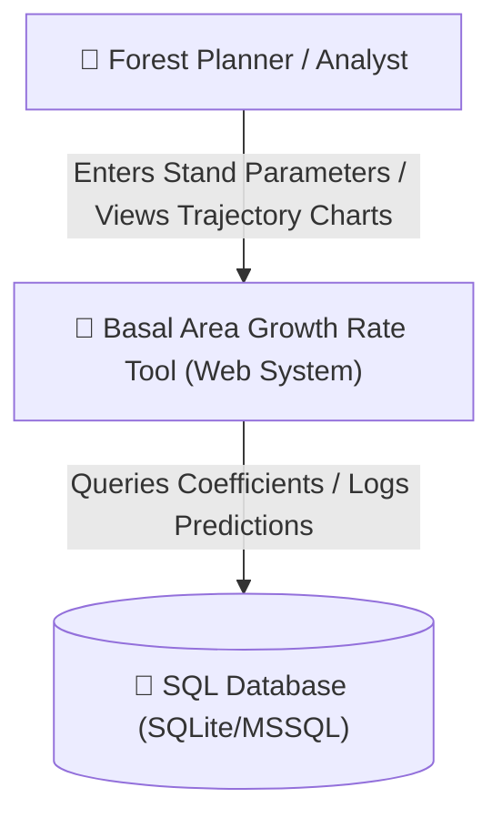
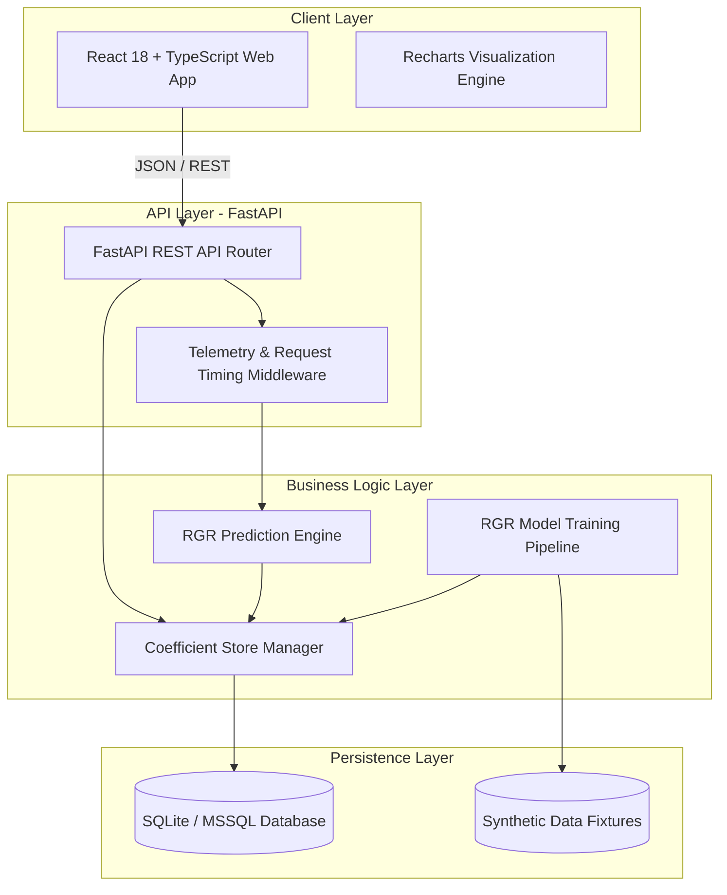
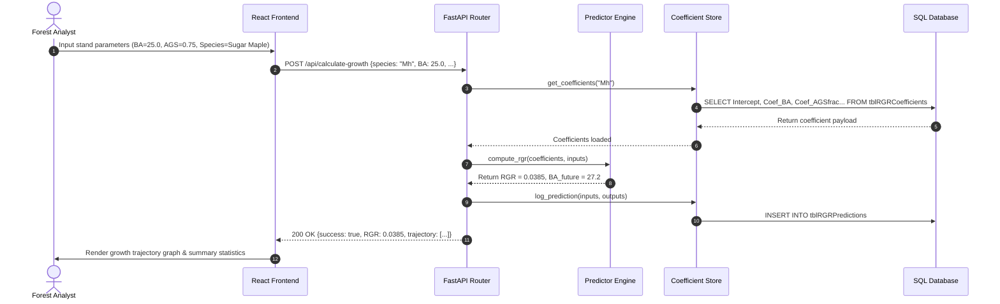
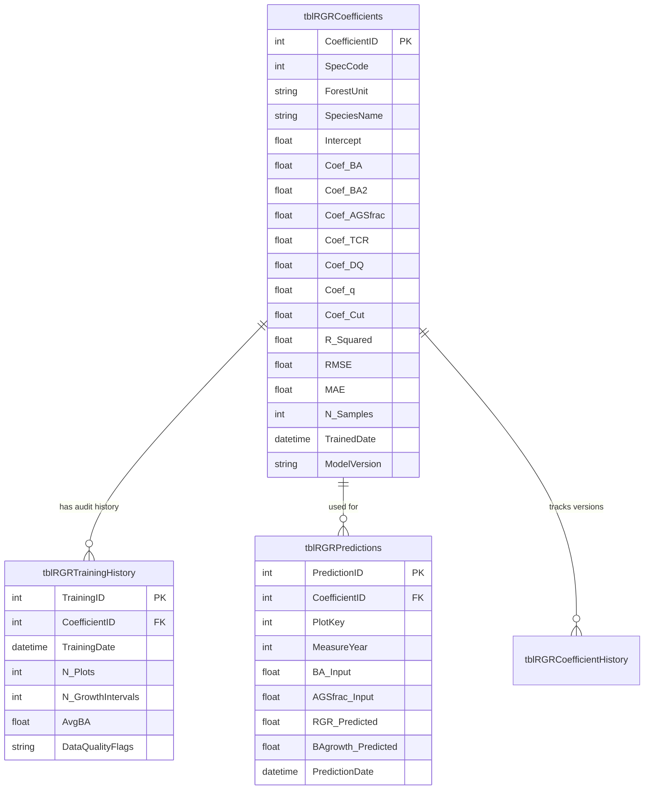

# System Architecture & Technical Design Document

This document outlines the high-level system design, data flow, component breakdown, and database relationships of the **Basal Area Growth Rate Analytics System**.

---

## 1. High-Level C4 Architecture Diagrams

### C4 Level 1: System Context Diagram



---

### C4 Level 2: Container Diagram (System Architecture)



---

## 2. API Sequence Diagram (Prediction Flow)



---

## 3. Database Entity-Relationship (ER) Diagram



---

## 4. Architectural Design Principles

1. **Separation of Concerns**: Clean isolation between UI visualization, FastAPI routing, domain prediction engines, and database abstraction layers.
2. **Environment Interoperability**: Automatic fallback between lightweight local SQLite storage (for zero-dependency development) and enterprise MSSQL servers.
3. **Auditability & Traceability**: Immutable prediction logs (`tblRGRPredictions`) and training run histories (`tblRGRTrainingHistory`) ensure complete computational reproducibility.
4. **Performance Optimization**: Request timing middleware (`X-Process-Time`) and response caching in frontend components minimize latency.

## 5. Model Benchmark Subsystem (`backend/ml`)

```mermaid
graph LR
    CLI[scripts/benchmark_models.py] --> B[ml.benchmark.benchmark_all]
    API[POST /api/benchmarks/run · background job] --> B
    B --> F[ml.features · base / extended / spatial design matrix]
    B --> R[ml.registry · 17 candidate estimators]
    B --> E[ml.evaluation · grouped / temporal / naive CV · metrics]
    B --> C[ml.conformal · split-conformal + quantile GBM intervals]
    B --> S[ml.stats · paired t · Wilcoxon · bootstrap CI · ranking]
    B --> W[ml.reports · benchmark_<ts>.json + LEADERBOARD.md]
    W --> G[GET /api/benchmarks · /api/benchmarks/{group}]
    G --> UI[Model Benchmarks tab · React + Recharts]
```

Design decisions:

- **Plot-grouped CV is the primary split.** Permanent sample plots are
  remeasured; treating intervals as independent rows leaks plot identity into
  the test fold. The naive split is still computed, purely to quantify that
  inflation.
- **The production OLS is always in the comparison** (it is inserted if the
  caller omits it) so every leaderboard answers "is anything better than what we
  ship?", with paired tests on the same folds.
- **Optional back-ends degrade gracefully.** Missing `xgboost`, `lightgbm` or
  `statsmodels` removes those rows from the leaderboard rather than failing the
  run; `/api/benchmarks/models` reports availability.
- **Reports are plain JSON on disk.** The API serves the newest file; the job
  registry shared with training exposes progress. No database schema change was
  needed for the first iteration (a `tblBenchmarkRuns` table is on the roadmap).
